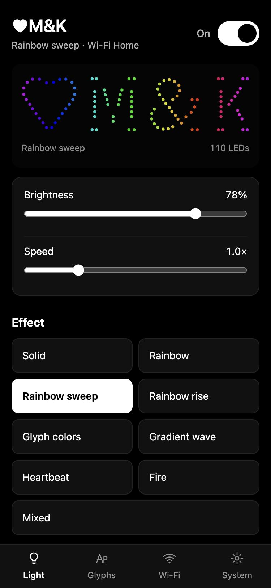
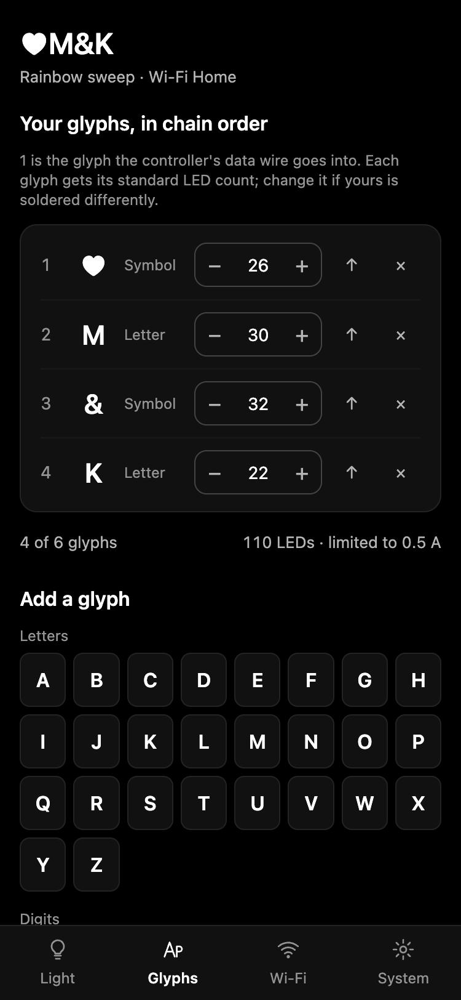
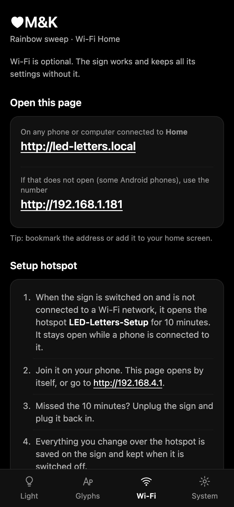

# LED Letters

Firmware and phone app for modular 3D-printed LED letters. An ESP32-C3 drives WS2812B glyphs
(A–Z, 0–9, & @ # ♥): chain up to six, set them up from your phone, no app or coding needed.

<p align="center">
  
  
  
</p>

The printable glyphs (case, LED insert and diffuser for every letter, digit and symbol) are on
**MakerWorld** (coming soon), together with the soldering guide. This repository holds everything else.

## Features

- **Modular.** Any word from 40 glyphs: A–Z, 0–9, `&`, `@`, `#` and `♥`. Each glyph knows its LED
  layout, so effects move across the sign as a whole.
- **Set up from a phone.** The controller opens its own Wi-Fi hotspot; the setup page opens by
  itself. Pick your glyphs in chain order, adjust LED counts if you soldered differently, done.
- **Wi-Fi is optional.** Everything works over the hotspot and is saved on the controller. Join your
  home network to control the sign any time at `http://led-letters.local`.
- **Live preview.** The app draws your real sign and animates the current effect.
- **Effects:** Solid, Rainbow, Rainbow sweep, Rainbow rise, Glyph colors, Gradient wave, Heartbeat,
  Fire, and Mixed (a different effect per glyph). Brightness, speed, two colours, auto-cycle.
- **Safe power.** The LED current is limited (500 mA by default) and brightness is scaled down
  automatically to stay under it.
- **One button.** The board's BOOT button switches effects and power, and resets Wi-Fi.

## Quick start

1. **Print and build** the glyphs from MakerWorld following the soldering guide, and chain them (OUT → IN).
2. **Wire** the first glyph to an ESP32-C3: data to **GPIO 4**, 5 V and GND. See [docs/hardware.md](docs/hardware.md).
3. **Flash** the firmware from your browser, no software to install: download
   `led-letters-esp32c3-full.bin` from [Releases](https://github.com/maciejfic/led-letters/releases)
   and follow [docs/flashing.md](docs/flashing.md).
4. **Set up** on your phone: join the Wi-Fi network **LED-Letters-Setup**, add your glyphs, save.

The step-by-step guide with screenshots is [docs/user-guide/led-letters-user-guide.pdf](docs/user-guide/led-letters-user-guide.pdf).

## Hardware

| Part | Notes |
|---|---|
| ESP32-C3 board with USB-C | e.g. ESP32-C3 SuperMini. Any C3 board works; pins are set in `config.h`. |
| WS2812B LED strip, 5 V | 10 mm wide, 60 LEDs/m (16.6 mm pitch) to fit the glyph inserts. |
| JST SM 3-pin connectors | One pair per glyph (IN and OUT), so the glyphs plug together. |
| 5 V power supply | USB from a phone charger for small signs; a stable 5 V supply for 5–6 glyphs. |
| 330 Ω resistor (optional) | In series with the data line, close to the first LED. |

Default pins: LED data **GPIO 4**, button **GPIO 9** (the on-board BOOT button).
Details and wiring: [docs/hardware.md](docs/hardware.md).

## Repository layout

```
firmware/LedLetters/   Arduino sketch (ESP32-C3)
  config.h             pins, limits, network names - start here to customise
  glyph_data.h         generated glyph catalog (do not edit)
  layout.*             builds the sign from the saved glyph list
  effects.*            effect engine
  net.*                Wi-Fi, setup hotspot, web server and API
  settings.*           settings stored on the controller
  web_ui.h             the phone app (HTML/CSS/JS)
tools/
  gen_glyphs.py        regenerates glyph_data.h from the glyph design files
  mock_server.py       runs the phone app on your computer without a board
docs/                  hardware, flashing, development, API, user guide
```

## Building from source

Requirements: [Arduino IDE 2](https://www.arduino.cc/en/software) or `arduino-cli`,
**ESP32 core 3.3.x** (by Espressif) and **FastLED 3.10.x**.

```bash
arduino-cli compile --fqbn esp32:esp32:esp32c3:CDCOnBoot=cdc firmware/LedLetters
arduino-cli upload  --fqbn esp32:esp32:esp32c3:CDCOnBoot=cdc -p /dev/cu.usbmodem2101 firmware/LedLetters
```

In Arduino IDE: board **ESP32C3 Dev Module**, **USB CDC On Boot: Enabled**. More in
[docs/flashing.md](docs/flashing.md) and [docs/development.md](docs/development.md).

Every push builds the firmware on GitHub Actions; tagging `v*` attaches ready-to-flash binaries to the release.

## Documentation

| Document | For |
|---|---|
| [User guide (PDF)](docs/user-guide/led-letters-user-guide.pdf) | Everyone: flashing from the browser, setup, daily use, troubleshooting |
| [Hardware](docs/hardware.md) | Parts, wiring, power |
| [Flashing](docs/flashing.md) | Browser flasher, Arduino IDE, arduino-cli |
| [Development](docs/development.md) | Architecture, layout system, adding glyphs and effects, app preview |
| [API](docs/api.md) | The HTTP API used by the phone app |

## License

[MIT](LICENSE). The 3D models on MakerWorld are published under their own license there.
